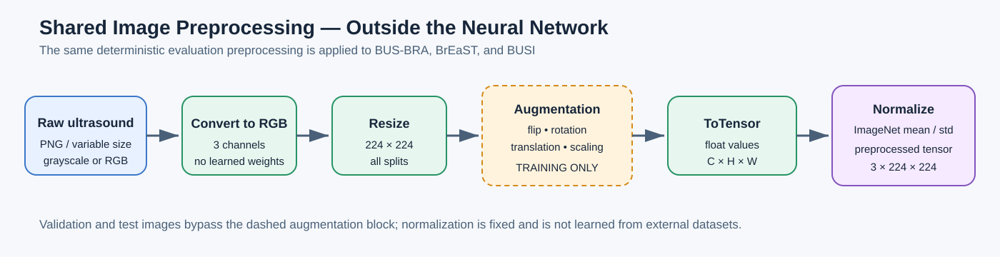
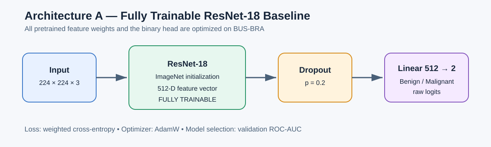
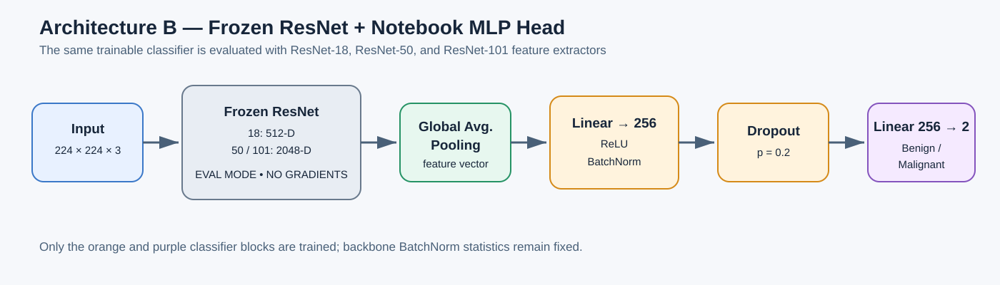
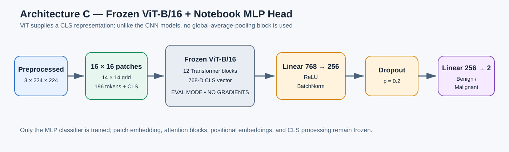

# CrossMed Model Architectures

CrossMed compares two classifier designs. Both consume the same 224 x 224
three-channel image, use ImageNet initialization, produce two raw logits, and
are evaluated on exactly the same fixed dataset manifests.

## Shared preprocessing



Preprocessing runs in the dataset loader before the tensor reaches any model.
Augmentation is enabled only for the BUS-BRA training split. Validation,
in-domain test, and both external tests use only RGB conversion, resizing,
tensor conversion, and fixed ImageNet normalization.

## Architecture A: simple fine-tuning baseline



```text
Image -> pretrained backbone -> feature vector -> Dropout(0.2)
      -> Linear(feature_dim, 2) -> benign/malignant logits
```

The full backbone is trainable. This is the primary baseline because it adds
minimal task-specific capacity.

Default configuration: `configs/baseline.yaml`

```yaml
model:
  architecture: resnet18
  pretrained: true
  freeze_backbone: false
  head: simple
  dropout: 0.2
```

## Architecture B: reference-notebook transfer learning



The supplied reference notebook uses a frozen ImageNet feature extractor and
the following classifier:

```text
Image -> frozen pretrained CNN -> Global Average Pooling
      -> Linear(feature_dim, 256) -> ReLU -> BatchNorm
      -> Dropout(0.2) -> Linear(256, 2) -> logits
```

The notebook applies L2 regularization with strength `1e-4`; the PyTorch
implementation uses AdamW `weight_decay: 0.0001`. The notebook's final softmax
is omitted inside the PyTorch model because `CrossEntropyLoss` requires raw
logits. Evaluation applies softmax to obtain probabilities.

When a backbone is frozen, CrossMed also keeps it in evaluation mode during
head training. This prevents BatchNorm running statistics and backbone dropout
state from changing, matching the notebook's `baseModel(..., training=False)`.

Default reproduction configuration: `configs/notebook_architecture.yaml`

```yaml
model:
  architecture: resnet50
  pretrained: true
  freeze_backbone: true
  head: notebook_mlp
  hidden_dim: 256
  dropout: 0.2
```

| Notebook name | CrossMed name |
|---|---|
| VGG16 | `vgg16` |
| ResNet50 | `resnet50` |
| ResNet101 | `resnet101` |
| EfficientNetB0 | `efficientnet_b0` |

For CNNs, torchvision already performs global average pooling in ResNet and
EfficientNet. CrossMed explicitly changes VGG16 to adaptive 1 x 1 average
pooling to match the notebook's default `poolingType="gap"` behavior.

## Planned experiment matrix

The primary systems are:

1. Fully trainable ResNet-18 with the simple head.
2. Frozen ResNet-18 with the notebook MLP head.
3. Frozen ResNet-50 with the notebook MLP head.
4. Frozen ResNet-101 with the notebook MLP head.
5. Frozen ViT-B/16 with the notebook MLP head.

Comparing experiments 2-4 keeps the training strategy and classifier fixed,
so the main changed variable is ResNet capacity. Comparing experiments 1 and 2
is not a pure freezing ablation because their heads also differ. If time allows,
add a frozen ResNet-18 with the simple head to isolate freezing from head depth:

```yaml
# Controlled run 1
architecture: resnet18
freeze_backbone: true
head: simple
```

Keep the seed, manifests, augmentation, optimizer, training budget, and model
selection criterion identical. Compare in-domain performance and both external
generalization gaps.

For frozen ViT-B/16, the encoder's 768-dimensional CLS representation is fed
to the same 256-unit MLP. ViT does not use the CNN global-average-pooling step.



All primary systems are registered in `configs/experiment_matrix.yaml`. They
can be trained through `crossmed-run` or notebook 02 and evaluated through
notebook 03. Aggregate results are saved to `results/model_comparison.csv`.

For memory-limited local notebook runs, the matrix runner can unload cached GPU
state between architectures. This is opt-in and is not required when CARC runs
one configuration per independent job.

## Output dimensions

| Backbone | Feature dimension | Simple head | Notebook head |
|---|---:|---|---|
| ResNet-18 | 512 | 512 -> 2 | 512 -> 256 -> 2 |
| ResNet-50 | 2048 | 2048 -> 2 | 2048 -> 256 -> 2 |
| ResNet-101 | 2048 | 2048 -> 2 | 2048 -> 256 -> 2 |
| EfficientNet-B0 | 1280 | 1280 -> 2 | 1280 -> 256 -> 2 |
| VGG16 with GAP | 512 | 512 -> 2 | 512 -> 256 -> 2 |
| ViT-B/16 | 768 | 768 -> 2 | 768 -> 256 -> 2 |
